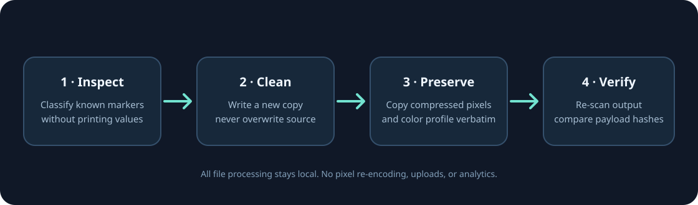

# PixelVeil

<p align="center">
  
</p>

<p align="center"><strong>Image metadata inspection and cleaning that stays on your device.</strong></p>

<p align="center">
  
</p>

PixelVeil removes common privacy metadata from JPEG, PNG, WebP, and GIF files without re-encoding their image data. It is a small Python application with no runtime package dependencies. The optional desktop interface uses Tkinter; the command line works without a graphical desktop.

## What it does

- Inspects recognized metadata categories without printing the stored values.
- Flags common AI image prompt/workflow field names and IPTC digital-source declarations as heuristic indicators.
- Reports preserved JPEG application segments and quantization tables as possible encoder characteristics.
- Removes common EXIF, XMP, IPTC, text/comment, and modification-time containers.
- Preserves color profiles and content provenance by default.
- Removes detected C2PA provenance only after an explicit `--remove-provenance` choice.
- Writes a separate output file, refuses to overwrite, and verifies that the encoded image payload hash is unchanged.
- Handles images locally; it does not make network requests or upload files.

## Quick start

Python 3.10 or later is required.

```bash
python -m pip install .
pixelveil inspect photo.jpg
pixelveil clean photo.jpg
pixelveil diff photo.jpg photo.cleaned.jpg
```

The cleaned file is created next to the source as `photo.cleaned.jpg`. To choose a folder:

```bash
pixelveil clean photo.jpg --output-dir cleaned/
```

Inspect or clean a folder. `--recursive` includes nested folders:

```bash
pixelveil inspect ./photos --recursive --json
pixelveil clean ./photos --recursive --output-dir ./cleaned
```

`diff` compares detected metadata categories and the compressed image payload hash between two files.

To also remove the C2PA/content provenance block where recognized:

```bash
pixelveil clean photo.jpg --remove-provenance
```

This removes recognized provenance blocks and makes the associated authenticity history unavailable. The C2PA specification also allows JPEG APP11 segments for other applications, so PixelVeil only treats APP11 segments as C2PA when their contents contain recognizable C2PA/JUMBF indicators; unknown APP11 data is preserved. PixelVeil does not verify provenance signatures.

Open the optional desktop interface with:

```bash
pixelveil gui
```

Tkinter must be available in the Python installation for the desktop interface.

## How it works

1. Read the file and identify its container format.
2. Parse supported metadata markers while preserving unknown structures and color profiles.
3. Create a new cleaned copy; the source file is left intact.
4. Parse the copy again and compare SHA-256 hashes of the compressed image payloads.

PixelVeil does not decode and re-encode image pixels as part of cleaning. Its verification means the encoded image payload bytes were unchanged; the test suite also decodes real sample files and checks their pixel values. See the [format support and limits](docs/format-support.md) for precise behavior.

## Tests

The runtime is dependency-free. To install the optional test dependency and run the suite:

```bash
python -m pip install -e '.[test]'
python -m unittest discover -s tests -v
```

GitHub Actions runs the suite on Python 3.10–3.13 across Ubuntu, macOS, and Windows.

## Limits

PixelVeil removes recognized metadata containers. It cannot reliably identify every private or vendor-specific field, unknown container chunk, data appended by a specialized tool, visual watermark, steganographic payload, or identifying content visible in the image itself. Some metadata-like chunks are intentionally preserved for compatibility. The tool is not an anonymity guarantee. Keep your original files and review the reported remaining markers for sensitive uses.

AI prompt, workflow, and IPTC findings are heuristic metadata indicators. They do not prove that an image was generated by a particular system, and absence of a finding does not prove the image is free of provenance or identifying information. PixelVeil does not detect or remove robust pixel-domain watermarks.

## License

MIT. See [LICENSE](LICENSE).
